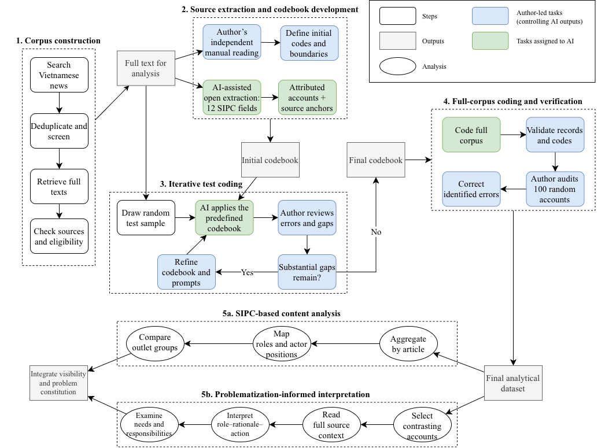

```{r}
#| label: setup-methods
#| include: false

library(tidyverse)
library(kableExtra)
source("format/tables.R")

# Locate project data when rendering from manuscript/ or the project root.
project_root <- if (file.exists("results/article_coding.csv")) "." else ".."

articles <- read_csv(file.path(project_root, "results/article_coding.csv"),
                     na = "", show_col_types = FALSE)
outlets <- read_csv(file.path(project_root, "data/outlet_classification.csv"),
                    show_col_types = FALSE)
main <- articles |> filter(main_sample == 1)

stopifnot(
  !anyDuplicated(articles$article_id),
  !anyDuplicated(outlets$outlet_domain),
  !anyNA(articles$main_sample),
  all(articles$main_sample %in% c(0, 1)),
  all(articles$outlet_domain %in% outlets$outlet_domain),
  all(main$eligibility == "clear_future"),
  all(articles$outlet_group ==
      outlets$outlet_type[
        match(articles$outlet_domain, outlets$outlet_domain)
      ])
)
```


```{r}
#| label: setup-analysis
#| include: false

book <- jsonlite::fromJSON(file.path(project_root,
  "data/sipc_future_coding/codebook.json"), simplifyVector = FALSE)
field_names <- c(future_role = "Future role", certainty = "Certainty",
  desirability = "Desirability", rationale = "Rationale",
  technology_object = "Technology characteristics", education_context = "Technology context",
  timespan = "Timespan", space = "Space", speaker = "Speaker",
  affected_entities = "Affected entities", action = "Action recommendation",
  responsibility = "Action responsibility")
labels <- imap_dfr(book$fields, function(entries, field) {
  map_dfr(entries, function(e) tibble(field = field, code = e$code,
                                     category = sub("Judgment", "Judgement", e$label, fixed = TRUE)))
})
roles <- labels |> filter(field == "future_role") |>
  mutate(short = c("LP", "EJ", "EM", "AL", "ND"))
role_ids <- roles$code
records <- lapply(readLines(file.path(project_root,
  "data/sipc_future_coding/coded_corpus.jsonl"), warn = FALSE),
  jsonlite::fromJSON, simplifyVector = FALSE)
records <- Filter(function(x) x$ID %in% main$article_id, records)
stopifnot(length(records) == nrow(main),
          setequal(vapply(records, `[[`, character(1), "ID"), main$article_id),
          all(paste0("future_role__", role_ids) %in% names(main)))
accounts <- map_dfr(records, function(record) {
  map_dfr(seq_along(record$accounts), function(i) {
    a <- record$accounts[[i]]
    tibble(article_id = record$ID, account = i,
           position = a$position, codes = list(a$codes))
  })
}) |> left_join(main |> select(article_id, outlet_group), by = "article_id")
# Keep role–field links within one attributed account, then deduplicate by article.
linked <- pmap_dfr(accounts, function(article_id, account, position, codes, outlet_group) {
  rr <- intersect(unlist(codes$future_role), role_ids)
  if (!length(rr)) return(tibble())
  imap_dfr(codes[names(codes) != "future_role"], function(values, field) {
    crossing(role = rr, code = unlist(values)) |>
      mutate(article_id, account, position, outlet_group, field)
  })
})
role_articles <- linked |> distinct(article_id, outlet_group, role)
role_pairs <- linked |> filter(code != "MISSING") |>
  distinct(article_id, outlet_group, role, field, code)
role_n <- function(role, group = NULL) {
  d <- role_articles |> filter(.data$role == .env$role)
  if (!is.null(group)) d <- d |> filter(outlet_group == group)
  nrow(d)
}
role_count <- function(role, code, group = NULL, field = NULL) {
  d <- role_pairs |> filter(.data$role == .env$role, .data$code == .env$code)
  if (!is.null(group)) d <- d |> filter(outlet_group == group)
  if (!is.null(field)) d <- d |> filter(.data$field == .env$field)
  n_distinct(d$article_id)
}
# Missing means no substantive code in this field in any account bearing this role.
role_missing <- function(role, field, group = NULL) {
  d <- role_pairs |> filter(.data$role == .env$role, .data$field == .env$field)
  if (!is.null(group)) d <- d |> filter(outlet_group == group)
  role_n(role, group) - n_distinct(d$article_id)
}
article_count <- function(code, data = main) {
  stopifnot(code %in% names(data))
  sum(data[[code]] == 1, na.rm = TRUE)
}
pct <- function(code, data = main) sprintf("%.1f", 100 * article_count(code, data) / nrow(data))
rp <- function(role, code, group = NULL, field = NULL) {
  sprintf("%.1f", 100 * role_count(role, code, group, field) / role_n(role, group))
}
cell <- function(n, denominator) sprintf("%d (%.1f)", n, 100 * n / denominator)
for (r in role_ids) {
  stopifnot(setequal(role_articles$article_id[role_articles$role == r],
    main$article_id[which(main[[paste0("future_role__", r)]] == 1)]))
}
# Existing primary designation is retained; it is not recoded for this manuscript.
primary <- main
for (record in records) {
  selected <- Filter(function(a) identical(a$position, "primary"), record$accounts)
  stopifnot(length(selected) == 1L)
  i <- match(record$ID, primary$article_id)
  for (field in names(selected[[1]]$codes)) {
    values <- setdiff(unlist(selected[[1]]$codes[[field]]), "MISSING")
    cols <- grep(paste0("^", field, "__"), names(primary), value = TRUE)
    for (column in cols) {
      suffix <- sub(paste0("^", field, "__"), "", column)
      primary[[column]][i] <- if (suffix == "missing") as.integer(!length(values)) else
        if (length(values)) as.integer(suffix %in% values) else NA_integer_
    }
  }
}
publication_groups <- c("public/central", "commercial/general")
role_prevalence <- map_dfr(role_ids, function(r) {
  vals <- vapply(c("All", publication_groups), function(g) {
    d <- if (g == "All") main else filter(main, outlet_group == g)
    cell(article_count(paste0("future_role__", r), d), nrow(d))
  }, character(1))
  tibble(Role = roles$category[match(r, role_ids)],
         All = vals[[1]], Public = vals[[2]], Commercial = vals[[3]])
})
profile_rows <- labels |> filter(field != "future_role") |>
  bind_rows(tibble(field = names(field_names)[-1], code = "MISSING",
                   category = "No assigned substantive code")) |>
  arrange(match(field, names(field_names)), code == "MISSING",
          match(code, labels$code))
profile_table <- function(group = NULL) {
  rows <- profile_rows
  for (i in seq_len(nrow(roles))) {
    r <- role_ids[[i]]
    rows[[roles$short[[i]]]] <- map2_chr(rows$field, rows$code, function(f, c) {
      n <- if (c == "MISSING") role_missing(r, f, group) else role_count(r, c, group, f)
      cell(n, role_n(r, group))
    })
  }
  groups <- rows |> count(field, name = "rows") |>
    arrange(match(field, names(field_names)))
  lmt_table(rows |> select(category, all_of(roles$short)),
    col.names = c("Category", paste0(roles$short, " (n=",
      vapply(role_ids, role_n, integer(1), group = group), ")")),
    widths = c(5.8, rep(1.55, 5)),
    groups = setNames(groups$rows, field_names[groups$field]), font_size = 8)
}
```
# Introduction

AI, like other emerging technologies before it, arrives with expansive promises for educational reform. Yet these aspirations are rarely novel; instead, they rearticulate a familiar list of expectations, such as personalising instruction, easing administrative burdens, or expanding access [@williamson2020; @selwyn2022]. Recurring cycles of technological hype suggest that core expectations for education persist across technological shifts, as long-standing institutional problems are repeatedly reattached to whichever new tool, conveniently, promises to solve them.

However, the persistence of these expectations does not imply that they manifest identically across all settings. Which futures acquire significance depends on societal judgements about national needs and priorities. In a study comparing the UK, China, and India, @wang2025 found greater anxiety in British newspapers about employment and national standing, whereas Chinese and Indian coverage gave more attention to economic opportunities. Similarly, @brause2024 identified differences in how improvement was framed in AI-enhanced healthcare across China, Germany, and the United States. Likewise, @richter2025 trace how state, market, and civic actors negotiate distinct approaches to governance and innovation. @chung2026 showed how a shared imperative of socioeconomic survival supported technocratic governance in Singapore, economic nationalism in Taiwan, and entrepreneurial intermediation within Chinese state capitalism in Hong Kong.

Although most are not specifically focused on education, these studies show how collective ambitions confer purpose upon AI. Explaining these demands for reform, however, also requires examining how existing educational practices are framed as lacking. This perspective aligns closely with problematisation, which maintains that problems do not simply exist "out there" awaiting solutions, but are actively constituted through the very proposals advanced to address them [@bacchi2012]. Extending this logic to educational imaginaries, Rahm [-@rahm2023; @rahmskageby2023] demonstrates that emerging technologies do not merely resolve pre-existing difficulties; they actively generate new imperatives that education is subsequently expected to fulfil. Bringing these frameworks together shifts analytical attention to the specific rationales that legitimise a technical future.

In formulations of sociotechnical imaginaries, the power to institutionalise visions rests primarily with the state through formal policy instruments and national agendas [@jasanoff2015]. Consequently, policy documents have served as the primary site for examining these imaginaries, though they capture them only in their officialised forms. News discourse opens a setting for examining these imaginaries in motion, making visible the process through which officials, EdTech providers, experts, and practitioners justify what should change and why [@brause2025]. Visibility in such coverage is unevenly distributed among institutional authorities, educators, and learners [@huang2025]. The analysis must therefore attend to which educational conditions are made problematic, which proposed arrangements receive scrutiny, and whose experience and expertise support those judgements.

Vietnam’s technological ambitions assign education a dual role in national development: a domain for technology adoption and a provider of workforce capabilities [@vietnam2021; @vietnam2022]. News outlets communicate these ambitions within a media system defined by party-state supervision alongside commercial competition [@nguyenthu2019; @luong2022]. Central/public outlets have closer institutional links to central party-state bodies and policy communication, whereas general/commercial outlets place greater emphasis on broad audiences and commercial publishing. These differing orientations may shape which futures, rationales, and voices each foregrounds, making the comparison between them informative.

Prior research shows that AI futures are framed differently across national, institutional, and stakeholder settings. Policy-focused research has examined how AI futures justify educational change [@linderoth2024], yet less attention has been given to how the rationales attached to these futures establish present educational shortcomings as grounds for reform, and how those justifications are distributed across news coverage. Analysing these rationales offers a way to examine how judgements about educational problems are publicly established. Three questions guide this analysis:

> RQ1. Which roles for AI in educational futures are articulated in Vietnamese news, and how are they evaluated and justified?

> RQ2. How do the visibility of these futures, their evaluations, and their speakers differ between central and commercial outlets?

> RQ3. How are educational problems constituted through the justification of imagined AI futures in Vietnamese news discourse, and which consequences of those futures remain outside the problems as represented?

This study extends policy-based work on imagined futures and the problems they are used to justify to news discourse, asking which educational conditions AI futures make problematic and who is authorised to define those concerns. Comparing central and commercial outlets examines how institutional profiles relate to the visibility of these futures and the actors articulating them. This approach brings the public distribution of AI futures into the analysis of the educational reasons offered for pursuing them.

# Literature Review

## Sociotechnical imaginaries and problematisation

Sociotechnical imaginaries situate technological progress within broader visions of desirable social order, connecting collectively held futures to the institutions that legitimise them [@jasanoff2015]. Within these visions, education is assigned a dual responsibility: it must cultivate the skills and capabilities required by a tech-driven society while helping realise its promised benefits [@rahmautomation2023; @rahm2023]. What presents itself as a mere technological possibility thus carries a normative judgement about how education ought to change.

Yet the promise of technological improvement relies on underlying assumptions about what constitutes "better" education. Varying priorities, such as economic competitiveness, expanded access, responsive instruction, or administrative support for teachers, assign distinct purposes to AI capabilities [@bulathwela2021; @hrastinski2019; @nemorin2023]. While these objectives can align, tensions emerge when measurable performance or speed of completion overshadows broader pedagogical values [@mamlok2025; @wieczorek2026]. Framing an AI tool as “efficient” or “personalised” is therefore not a neutral description but a value judgement that sets criteria for educational success. A sociology of educational AI treats such choices about educational purpose and organisation as open to scrutiny [@shi2026].

To analyse how these judgements justify action, problematisation examines the specific problem implicit within a proposed solution. Following @bacchi2012, a problem representation is the account of what requires change embedded in a proposal. Examining its assumptions shows how a condition is constituted as a problem and which responses become reasonable. Studies of AI guidelines and EdTech development show how educational concerns enter policy and commercial projects in this way [@horvath2025; @linderoth2024]. Combined with sociotechnical imaginaries, this shows how envisioned futures supply the benchmark against which present practices are found wanting [@rahmskageby2023]. When continuous individual feedback is promoted as an ideal capability, for instance, its present absence is redefined as a critical instructional flaw, so the imagined technology helps construct the very problem it claims to resolve.

Shared commitments leave room for different judgements. Commitments to equity can coexist with data practices that hinder it [@macgilchrist2019], and visions centred on seamless information delivery privilege particular understandings of learning [@wieczorek2026]. Agreement on a core educational value therefore does not settle the arrangements that should follow from it. Problem representations also establish boundaries around what receives scrutiny. Ferrante and colleagues examine what digital education policies leave unproblematised, including ecological costs and inequalities obscured by an emphasis on digital participation [@ferrante2024]. Their approach supports asking which consequences of a proposed future become grounds for intervention and which remain outside its justification. The same logic applies to criticism: warnings about AI can justify restrictions or expanded training, while counter-visions can challenge established arrangements [@cave2019; @selwyn2022]. @pastore2025 likewise identifies reductionist assumptions shared by technological promises and fears. Attending to rationale, role, and action together keeps such disagreements visible within an apparently shared aspiration for better education.

This study therefore treats the rationale behind each imagined future role as a diagnostic window into how educational challenges are defined. On its own, a rationale gives reasons for an evaluation and does not identify a problem representation. Read together with the anticipated role and proposed action, however, it indicates what present conditions are diagnosed as failing, inefficient, or worth protecting. This study applies that pairing to news to trace how educational “failures” are constructed and how specific solutions are legitimised, including which consequences remain outside the problem as represented.

## Public communication and the analysis of educational futures

Research on sociotechnical imaginaries has often centred on official policy, reflecting the concept’s concern with how state authority codifies collective visions into national priorities, formal responsibilities, and programmes of action [@jasanoff2015]. The review of energy imaginaries by @kuchlerstigson2024 likewise finds that the nation-state remains a central analytical entry point, despite growing attention to other collectives.

In education, @linderoth2024 combine sociotechnical imaginaries with problematisation to examine the assumptions about education contained in AI policy guidelines. Their approach treats proposed solutions as a point of entry into how educational problems are constituted. @ferrante2024 likewise combine imaginaries with Bacchi’s WPR approach in their analysis of digital education policy across six countries, examining how visions of a digital future connect with representations of inequalities requiring intervention. They situate these connections in local histories and wider technological developments. Together, these studies provide a methodological basis for examining imagined futures and problem representations through the proposals that link them.

Policy-centred inquiry illuminates institutionally sanctioned visions. The question for news research is how these connections are articulated and contested before wider audiences. Understanding how such visions build legitimacy, secure public resources, or meet opposition requires attention to public communication [@brause2025]. By reaching citizens, stakeholders, and decision-makers, news media help shape societal expectations of technologies. News thus offers a setting for examining how educational AI futures are promoted, whose judgements gain visibility, and how proposed reforms are justified to broader audiences.

Public debates about educational AI already contain demands to adapt institutions, revise practices, and protect valued forms of learning. Reporting on generative AI shows a persistent tension between concern about the technology’s outputs and the perceived inevitability of incorporating it into education, with disputes extending to research integrity, teaching methods, and governance in higher education [@kikerpill2023; @nam2023]. These disputes raise the question of what must be protected, what must be revised, and why that response takes priority.

Who answers that question shapes the educational reasoning available in public discussion. Research with teachers and developers reveals divergences between imaginaries grounded in everyday practice and those oriented towards ideal technological futures [@hrastinski2019], and news coverage of educational AI shows unequal representation of institutional actors, educators, and learners [@huang2025]. An account can invoke teachers or students as beneficiaries without giving their judgements a speaking position. Distinguishing who speaks, who is affected, and who must implement reform helps establish whose definition of educational need gains visibility. Those positions also need to be read with the problems receiving attention: the presence of several speakers does not establish that the assumptions or consequences of a proposed arrangement receive equivalent scrutiny.

The Sociotechnical Imaginaries in Public Communication (SIPC) framework retains these relationships within one analytical structure [@brause2025]. It links the role anticipated for a technology to its evaluation, the reasons offered for that evaluation, and the actors associated with its consequences and pursuit, across six dimensions and twelve analytical fields (@tbl-sipc). Comparison can thus follow the reasoning attached to a vision rather than treating benefits, risks, or actors as isolated themes.

| Theoretical dimension | Analytical field | Question guiding analysis |
|---|---|---|
| Vision | Future role | What educational or social change is expected, sought, or feared? |
| Vision | Certainty | How firmly is that outcome predicted? |
| Desirability | Desirability level | How does the speaker evaluate the anticipated change? |
| Desirability | Affected entities | Who is expected to experience its consequences? |
| Desirability | Rationale | What reasons or values support the evaluation? |
| Futures | Timespan | When is the change expected to occur? |
| Futures | Space | Where is it expected to apply? |
| Technological object | Technology characteristics | What form of AI is involved? |
| Technological object | Technology context | In what educational setting is it expected to operate? |
| Speaker | Speaker | Who articulates the future, and in what capacity? |
| Implications | Action recommendation | What action or restraint is proposed? |
| Implications | Action responsibility | Who is expected to act or be accountable? |

: SIPC dimensions and the questions used to examine educational AI futures. Adapted from @brause2025. {#tbl-sipc}

Anchoring comparison in future roles lets a single technology serve divergent educational ends. In healthcare, @brause2024 show how a broadly shared vision can contain differences in beneficiaries, evaluative grounds, and proposed arrangements, and comparative research finds variation across national settings and actor positions [@wang2025; @richter2025]. Connecting role, rationale, and action identifies the condition selected for intervention, the grounds on which it matters, and the response made reasonable. Shared values and contrasting interventions are useful for this purpose because they expose different definitions of the problem. The analytical question concerns how each justification directs attention to particular educational conditions and delimits scrutiny of its proposed future.

## Educational AI futures in Vietnam’s media context

Vietnam’s national AI ambitions position education as both a site for technological adoption and a provider of the workforce capabilities needed to develop and use AI. State policy frameworks, specifically the national AI strategy and the education digital transformation programme, outline priorities for training in AI and data science, personalised learning, instructional automation, and digitised management infrastructure [@vietnam2021; @vietnam2022]. These policy directions shape institutional expectations regarding how educational programmes operate and what capabilities educators and learners should develop. By August 2026, the national AI human-resource programme had linked training to technological autonomy and specified targets for applied and specialist capabilities [@vietnamaiworkforce2026]. Ministry guidance also set the implementation of school AI education from the 2026–2027 academic year [@vietnamaischools2026]. These commitments attach programmes and timetables to the national ambition. Examining how these initiatives are publicly justified provides an opportunity to trace how national development goals are translated into rationales for educational reform.

Vietnamese AI reporting frequently brings national development ambitions and commercial interests into the same news space. Research on major state newspapers identifies a prevailing optimism towards AI, alignment with national development goals, substantial industry participation, and limited attention to ethical issues [@nguyen2026]. Because that study focused specifically on state-run press, it leaves open how outlets with differing institutional profiles represent educational AI. These questions carry distinct analytical significance within a politically supervised media system. As @nguyenthu2019 observes, commercialisation in Vietnamese media evolves within shifting power relations. In online news, @luong2022 documents how technology firms participate in media production, balancing commercial objectives with continued reliance on party-state authorities. Commercial outlets actively engage young, middle-class, and business readerships across general topics while drawing on official sources for policy coverage. Focusing on education thus provides an empirical basis for examining how these political and commercial dynamics shape the public visibility of specific educational claims and authoritative voices.

These intersecting pressures provide a basis for comparing how central and commercial news outlets present educational AI futures. Central outlets are characterised by their institutional ties to central party-state organs and formal policy communication, whereas commercial outlets are defined by their orientation towards broader audiences and market-based publishing. This distinction concerns contrasting institutional profiles within a shared system of political supervision, rather than a binary between state and private ownership. Their differing positions regarding policy communication and audience demand offer grounds for examining variations in the concerns, speakers, and rationales for reform that each foregrounds, ultimately clarifying how national ambitions acquire educational justification and whose judgements shape its priorities.

# Methodology

## Research design and corpus construction

The study combined SIPC-based content analysis of public visibility with a problematisation-informed reading of educational needs and responsibilities (@fig-method-process). Articles were the units of sampling and descriptive comparison; attributed accounts were the coding units, preserving links among future roles, evaluations, rationales, and proposed responses.

{#fig-method-process width=100% fig-align="center"}

Google News RSS searches targeted 21 Vietnamese outlet domains and publications dated 2017–2026. Queries combined Vietnamese AI and education terms with named technologies. Full texts were retrieved after deduplication and screening, with incomplete sources recovered where possible and uninterpretable records flagged. Eligibility required an anticipated or normatively desired educational change involving AI. Screening and publisher verification reduced `r format(nrow(articles) + 17L, big.mark = ",", trim = TRUE)` working records to `r nrow(main)` eligible articles containing `r format(nrow(accounts), big.mark = ",", trim = TRUE)` attributed accounts from 20 outlets. Outlets were classified as central or commercial by institutional affiliation and publishing orientation, independently of article tone and coding outcomes (@tbl-outlet-classification).

```{r}
#| label: tbl-outlet-classification
#| tbl-colwidths: [22, 8, 70]
#| tbl-cap: "Classification of outlets."

main |>
  group_by(outlet_group) |>
  summarise(Articles = n(),
            Domains = str_c(sort(unique(outlet_domain)), collapse = "; "),
            .groups = "drop") |>
  mutate(outlet_group = factor(outlet_group,
                              c("public/central", "commercial/general")),
         outlet_group = recode(as.character(outlet_group),
                               "public/central" = "Central",
                               "commercial/general" = "Commercial")) |>
  arrange(match(outlet_group, c("Central", "Commercial"))) |>
  lmt_table(col.names = c("Outlet group", "Article count", "Included domains"),
    widths = c(3, 1, 9.6), align = c("l", "r", "l"))
```

## Extraction and coding

Author and AI analytical tasks were divided according to qualitative reporting guidance on researcher oversight, transparency, and substantive verification [@obrien2014; @jones2025; @dunivin2025; @morgan2023]. Open extraction preserved attribution, qualifications, and conflicting evaluations across twelve SIPC fields. Accounts were differentiated by speaker, envisioned arrangement, or evaluation target. Following independent purposive reading of source texts, the author constructed the codebook; AI applied only approved categories. Iterative test coding on random sample batches informed refinements to prompts and category definitions. Five core future roles were established (@tbl-role-definitions).

| Future role | Analytical boundary |
|---|---|
| AI as a Learning Partner | Changes to learning, learner development, and relations among learners, teachers, and AI. |
| AI as a Force Reshaping Educational Judgement | Changes to assessment, academic integrity, authenticity, and recognition of achievement or competence. |
| AI as an Educational Management Tool | Changes to operations, administration, institutional services, monitoring, and resource allocation. |
| AI Literacy as an Educational Imperative | Preparing people to understand, develop, critically use, and live or work with AI. |
| AI as a Driver of National Development | AI-related education or university research serving an explicitly stated collective, sectoral, or national development purpose. |

: Five future roles and their boundaries. Full inclusion and exclusion rules are retained in the codebook. {#tbl-role-definitions}

Desirability was coded per speaker and target, keeping positive, negative, and mixed evaluations distinct. Rationales were mapped across eight domains (learning; provision; equity; credibility; rights and wellbeing; economic prospects; collective development; adaptation). Ten actor categories (public authorities, teachers, learners, researchers, educational leaders, communities, business/industry, technology providers, institutions, families) were independently applied across speaking, affected, and responsible positions according to the capacity evidenced in each account.

OpenAI models accessed via Codex assisted with initial extraction and structured account coding from Vietnamese source texts. Automated checks verified structural and codebook compliance. Following automated processing, the author audited a random sample of 100 attributed accounts against original Vietnamese texts, manually correcting identified misclassifications (e.g., over-coded generic digital tools) and verifying all manuscript quotations. As a native Vietnamese speaker, the author made all final interpretive decisions and checked all AI-assisted translations. No second independent human coder was involved.

## Descriptive comparison and problematisation

For descriptive metrics, each code was counted once per article, using the total sample or relevant outlet subsample as the denominator; multiple assignments mean percentages do not sum to 100%. Role profiles required co-occurrence within the same attributed account and used the total articles containing that specific role as the denominator. Sensitivity checks, including primary-account aggregation and omission of each outlet in turn, assessed variation associated with prominence and outlet composition. Comparisons describe the retrieved corpus directly without population-level inferential claims. Supplementary documents provide the full role profiles, sensitivity checks, corpus-screening details, and AI workflow documentation.

Qualitative analysis applied Bacchi’s WPR problematisation logic [@bacchi2012] to linked role–rationale–action triads, interpreting how accounts construct educational deficiencies, establish standards of improvement, and assign responsibility [@linderoth2024; @rahmskageby2023]. Passages were selected for contextual close reading to represent contrasting perspectives, actor positions, and exceptions across outlet groups. Readings also identified unexamined consequences (e.g., governance or resource costs) left outside a proposal’s explicit justification. This interpretive phase provides contextual diagnostic insights into problem representations rather than a quantitative corpus-wide typology.


```{r}
#| label: setup-figures
#| include: false

figure_roles <- c(FR_LEARNING_PARTNER = "Learning Partner",
  FR_AI_LITERACY = "AI Literacy",
  FR_EDUCATIONAL_JUDGMENT = "Educational Judgement",
  FR_NATIONAL_DEVELOPMENT = "National Development",
  FR_EDUCATIONAL_MANAGEMENT = "Educational Management")
figure_theme <- theme_minimal(base_size = 10, base_family = "sans") +
  theme(panel.grid.minor = element_blank(),
    panel.grid.major.y = element_blank(),
    axis.title.y = element_blank(),
    axis.text = element_text(colour = "#252525"),
    strip.text = element_text(face = "bold", hjust = 0),
    legend.position = "bottom", legend.title = element_blank(),
    plot.margin = margin(8, 12, 8, 8))
outlet_colours <- c(Central = "#C23B3B", Commercial = "#24618A")
```

# Results

## Learning and preparation organise the anticipated changes

Learning Partner and AI Literacy were the most prevalent future roles, appearing in `r pct("future_role__FR_LEARNING_PARTNER")`% and `r pct("future_role__FR_AI_LITERACY")`% of articles, respectively (@fig-role-comparison). Together, they placed education in two relationships with AI: improving learning through the technology and preparing people to understand and use it. Educational Judgement formed a substantial third strand. National Development and Educational Management received less attention as explicit purposes of change.


Article-level prevalence by outlet group is reported in @tbl-role-prevalence.

```{r}
#| label: tbl-role-prevalence
#| tbl-colwidths: [46, 18, 18, 18]
#| tbl-cap: "Future-role prevalence by outlet group, articles n (%)."
lmt_table(role_prevalence,
  col.names = c("Future role", "All (828)", "Central (424)", "Commercial (404)"),
  widths = c(6.4, 2.4, 2.4, 2.4))
```

```{r}
#| label: fig-role-comparison
#| fig-cap: "Future-role visibility (A) and linked negative evaluations (B). A uses all group articles; B uses articles containing each role. Right-hand panels show central minus commercial, in percentage points."
#| fig-width: 6.7
#| fig-height: 6.2
#| out-width: 100%
#| fig-align: center
#| dpi: 300

role_plot_data <- crossing(role = names(figure_roles), group = publication_groups) |>
  mutate(Group = recode(group, "public/central" = "Central",
                        "commercial/general" = "Commercial"),
    visibility = map2_dbl(role, group, function(r, g) {
      d <- filter(main, outlet_group == g)
      100 * article_count(paste0("future_role__", r), d) / nrow(d)
    }),
    negative = map2_dbl(role, group, function(r, g)
      100 * role_count(r, "DES_NEGATIVE", g, "desirability") / role_n(r, g))) |>
  pivot_longer(c(visibility, negative), names_to = "panel", values_to = "percent") |>
  mutate(panel = factor(panel, c("visibility", "negative"),
    c("A  Role visibility", "B  Negative evaluation")),
    Role = factor(figure_roles[role], levels = rev(unname(figure_roles))))
stopifnot(all(is.finite(role_plot_data$percent)),
          all(role_plot_data$percent >= 0 & role_plot_data$percent <= 100))
role_differences <- role_plot_data |>
  select(panel, Role, Group, percent) |>
  pivot_wider(names_from = Group, values_from = percent) |>
  mutate(difference = Central - Commercial,
    higher = if_else(difference >= 0, "Central", "Commercial"))

role_dumbbell <- ggplot(role_plot_data, aes(percent, Role)) +
  geom_segment(data = role_differences,
    aes(x = Central, xend = Commercial, yend = Role),
    colour = "#AAB3BA", linewidth = .9) +
  geom_point(aes(colour = Group, shape = Group), size = 2.8) +
  facet_wrap(~ panel, ncol = 1) +
  scale_colour_manual(values = outlet_colours) +
  scale_shape_manual(values = c(Central = 1, Commercial = 17)) +
  scale_x_continuous(limits = c(0, 70), breaks = seq(0, 60, 20)) +
  labs(x = "Articles (%)") + figure_theme +
  theme(panel.spacing.y = grid::unit(1.4, "lines"),
    axis.text.y = element_text(size = 10))

role_difference_plot <- ggplot(role_differences, aes(difference, Role)) +
  geom_vline(xintercept = 0, colour = "#939393", linetype = "dashed", linewidth = .4) +
  geom_segment(aes(x = 0, xend = difference, yend = Role, colour = higher),
    linewidth = .7, show.legend = FALSE) +
  geom_point(aes(colour = higher), size = 2.2, show.legend = FALSE) +
  geom_label(aes(x = difference + if_else(difference >= 0, 2, -2),
    label = paste0(if_else(difference < 0, "\u2212", "+"),
                   sprintf("%.1f", abs(difference))),
    hjust = if_else(difference >= 0, 0, 1)),
    size = 3, colour = "#252525", fill = "white", label.size = 0,
    label.padding = grid::unit(.1, "lines")) +
  facet_wrap(~ panel, ncol = 1) +
  scale_colour_manual(values = outlet_colours) +
  scale_x_continuous(limits = c(-42, 42), breaks = c(-20, 0, 20)) +
  labs(x = "Difference (pp)") + figure_theme +
  theme(axis.text.y = element_blank(),
    strip.text = element_text(colour = "transparent"),
    panel.spacing.y = grid::unit(1.4, "lines"))

patchwork::wrap_plots(role_dumbbell, role_difference_plot,
  nrow = 1, widths = c(3.5, 1.6), guides = "collect") &
  theme(legend.position = "bottom")
```


Learning and human development was the most widespread rationale (`r pct("rationale__RATION_LEARNING")`% of all articles). Its prominence gave AI an educational purpose, but other rationales specified different grounds for change: provision and efficiency were prominent within Educational Management, credibility within Educational Judgement, and collective development within National Development (@fig-role-rationales). Within AI Literacy, preparation was justified through learning and future livelihoods and translated into proposals for curriculum reform and resource provision. These profiles identify the reasons attached to future roles; the source readings examine what those reasons made necessary to change.

```{r}
#| label: fig-role-rationales
#| fig-cap: "Rationales linked to each future role (% of articles containing the role). Role and rationale must occur in the same account; domains can overlap."
#| fig-width: 6.7
#| fig-height: 4.4
#| out-width: 100%
#| fig-align: center
#| dpi: 300

rationale_labels <- c(RATION_LEARNING = "Learning and human development",
  RATION_PROVISION = "Efficiency and educational provision",
  RATION_EQUITY = "Access and equity",
  RATION_CREDIBILITY = "Knowledge and academic credibility",
  RATION_RIGHTS = "Rights and wellbeing",
  RATION_ECONOMY = "Employment and economic prospects",
  RATION_COLLECTIVE = "Collective development and public life",
  RATION_ADAPTATION = "Adaptation to social and technological change")
rationale_plot_data <- crossing(role = names(figure_roles),
  code = names(rationale_labels)) |>
  mutate(percent = map2_dbl(role, code, function(r, c)
    100 * role_count(r, c, field = "rationale") / role_n(r)),
    Role = factor(role, levels = names(figure_roles)),
    Rationale = factor(code, levels = rev(names(rationale_labels))))
stopifnot(nrow(rationale_plot_data) == 40,
          all(is.finite(rationale_plot_data$percent)))
ggplot(rationale_plot_data, aes(Role, Rationale, fill = percent)) +
  geom_tile(colour = "white", linewidth = .6) +
  geom_text(aes(label = sprintf("%.1f", percent),
    colour = percent >= 40), size = 2.9, show.legend = FALSE) +
  scale_colour_manual(values = c("FALSE" = "#202020", "TRUE" = "white")) +
  scale_fill_gradient(low = "#F0F5F8", high = "#174A70", limits = c(0, 70),
    breaks = c(0, 20, 40, 60), name = "Articles (%)") +
  scale_x_discrete(labels = c("Learning
Partner", "AI
Literacy",
    "Educational
Judgement", "National
Development", "Educational
Management")) +
  scale_y_discrete(labels = function(x) str_wrap(rationale_labels[x], 32)) +
  labs(x = NULL) + figure_theme +
  theme(panel.grid = element_blank(), axis.text.x = element_text(size = 8),
        legend.title = element_text(size = 9))
```


Personalisation made responsiveness to individual learners a standard of adequate provision. A VioEdu/FPT representative argued that differences in pupils’ pace, strengths, and interests required a change in instruction:

> In the technological age, twenty-first-century classrooms need to focus on each individual’s strengths and interests, instead of simply applying some standardised knowledge as in traditional learning. This is precisely where AI can help us.
>
> Technology-provider contribution (VNE19_004)

The proposed system would identify difficulties, repeat material, recommend subsequent content, and alert teachers to incorrect answers. Within this account, the envisioned capacity to differentiate instruction made uniform provision the problem to address. The contribution connected that diagnosis to the provider’s own platform, turning a general concern about learner differences into a justification for a particular educational product.

Teacher accounts also connected technological assistance to learning relationships. A practising teacher described using AI-generated art materials:

> Teachers saved time preparing materials and had more time to guide pupils directly in drawing.
>
> Teacher’s authorial account (GDN25_004)

Time spent preparing lessons, tests, and feedback was presented as limiting the attention teachers could give pupils. That concern justified using AI to perform preparation tasks. The teacher also described attending free evening classes, repeating lessons, and paying for further training to learn how to use it. The anticipated relief from preparation work therefore depended on teachers undertaking additional professional learning.

## Institutional preparation and learner voice have different visibility

Central coverage gave greater weight to preparation and collective development. AI Literacy appeared in `r pct("future_role__FR_AI_LITERACY", filter(main, outlet_group == "public/central"))`% of central articles and `r pct("future_role__FR_AI_LITERACY", filter(main, outlet_group == "commercial/general"))`% of commercial articles; National Development appeared in `r pct("future_role__FR_NATIONAL_DEVELOPMENT", filter(main, outlet_group == "public/central"))`% and `r pct("future_role__FR_NATIONAL_DEVELOPMENT", filter(main, outlet_group == "commercial/general"))`%, respectively. Learning Partner and Educational Judgement had similar prevalence across the groups. The difference lay in the weight given to institutional and collective purposes within a shared set of futures.

Public authorities and educational leaders were more frequently represented as speakers in central coverage, whereas teachers’ speaking presence differed much less (@tbl-outlet-features). The contrast therefore concerned particular institutional positions rather than educators as a single group.

```{r}
#| label: tbl-outlet-features
#| tbl-colwidths: [56, 22, 22]
#| tbl-cap: "Selected speaking positions, rationales, and actions by outlet group, articles n (%)."
selected <- c("speaker__ACTOR_PUBLIC", "speaker__ACTOR_LEADER",
              "speaker__ACTOR_EDUCATOR", "speaker__ACTOR_RESEARCHER",
              "speaker__ACTOR_TECH_PROVIDER", "speaker__ACTOR_ORGANISATION",
              "speaker__ACTOR_LEARNER", "rationale__RATION_COLLECTIVE",
              "rationale__RATION_EQUITY", "rationale__RATION_RIGHTS",
              "action__ACT_CURRICULUM", "action__ACT_RESOURCES",
              "responsibility__ACTOR_PUBLIC", "responsibility__ACTOR_EDUCATOR",
              "responsibility__ACTOR_LEARNER", "responsibility__ACTOR_ORGANISATION")
rows <- labels |> mutate(key = paste0(field, "__", code)) |>
  filter(key %in% selected) |> arrange(match(key, selected))
for (g in publication_groups) {
  d <- filter(main, outlet_group == g)
  rows[[g]] <- map2_chr(rows$field, rows$code,
    function(f, c) cell(article_count(paste0(f, "__", c), d), nrow(d)))
}
groups <- rows |> count(field, name = "rows") |> arrange(match(field, .env$rows$field))
lmt_table(rows |> select(category, all_of(publication_groups)),
  col.names = c("Category", "Central (424)", "Commercial (404)"),
  widths = c(8, 2.8, 2.8), groups = setNames(groups$rows, field_names[groups$field]))
```


Learners were nearly universal as affected entities (`r pct("affected_entities__ACTOR_LEARNER")`%) but appeared as speakers in only `r pct("speaker__ACTOR_LEARNER")`% of articles. They were also assigned responsibility in `r pct("responsibility__ACTOR_LEARNER")`%. Commercial coverage included learner speech more frequently than central coverage (`r pct("speaker__ACTOR_LEARNER", filter(main, outlet_group == "commercial/general"))`% versus `r pct("speaker__ACTOR_LEARNER", filter(main, outlet_group == "public/central"))`%), although both discussed learners far more often than they included their judgements. @fig-actor-positions compares the three positions across all actor categories.

```{r}
#| label: fig-actor-positions
#| fig-cap: "Actor visibility as speakers, affected entities, and responsible actors (% of 828 articles). Categories can overlap."
#| fig-width: 6.7
#| fig-height: 4.5
#| out-width: 100%
#| fig-align: center
#| dpi: 300

actor_labels <- c(ACTOR_LEARNER = "Learners", ACTOR_EDUCATOR = "Teachers and educators",
  ACTOR_LEADER = "Educational leaders", ACTOR_RESEARCHER = "Researchers and specialists",
  ACTOR_PUBLIC = "Public authorities", ACTOR_TECH_PROVIDER = "Technology providers",
  ACTOR_ORGANISATION = "Organisations and institutions",
  ACTOR_OCCUPATIONAL = "Business and occupational groups",
  ACTOR_FAMILY = "Families and caregivers", ACTOR_COMMUNITY = "Communities and wider public")
actor_plot_data <- crossing(code = names(actor_labels),
  field = c("speaker", "affected_entities", "responsibility")) |>
  mutate(percent = map2_dbl(field, code, function(f, c)
    100 * article_count(paste0(f, "__", c)) / nrow(main)),
    Position = factor(field, c("speaker", "affected_entities", "responsibility"),
      c("Speaker", "Affected entities", "Responsibility")),
    Actor = factor(code, levels = rev(names(actor_labels))))
stopifnot(nrow(actor_plot_data) == 30,
          all(is.finite(actor_plot_data$percent)))
ggplot(actor_plot_data, aes(percent, Actor)) +
  geom_segment(aes(x = 0, xend = percent, yend = Actor),
               colour = "#CAD7DF", linewidth = .6) +
  geom_point(colour = "#24618A", size = 2.3) +
  geom_text(aes(label = sprintf("%.1f", percent)), hjust = -.4, size = 2.6) +
  facet_wrap(~ Position, nrow = 1) +
  scale_y_discrete(labels = function(x) str_wrap(actor_labels[x], 29)) +
  scale_x_continuous(limits = c(0, 115), breaks = c(0, 50, 100)) +
  labs(x = "Articles (%)") + figure_theme +
  theme(strip.text = element_text(face = "bold", hjust = 0, size = 9))
```


Where learners spoke, they articulated conditions for assistance as well as experiences of using it. A school pupil described ChatGPT as a second teacher but qualified the relationship:

> However, this is only a basis for me to consult, so that I can discuss it with my teachers in class or better understand what they explain.
>
> School pupil (TNI24_012)

Other pupils in the report described investigating AI-generated suggestions independently and limiting reliance because answers could be wrong. A master’s student’s commentary similarly proposed course-specific permissions, checking outputs, and explaining how AI had been used:

> If students do not intend to be transparent about their use of AI, they will not be allowed to use AI in learning.
>
> Master’s student’s authorial commentary (DTR24_018)

The student proposed that teachers specify permitted uses for each course and that learners verify outputs and disclose their use of AI.

Learners also identified unequal opportunities to prepare for the future as grounds for action. The leader of a pupil-led outreach project explained its purpose:

> The first project GAIK undertook was teaching AI to primary-school pupils, as an introduction to help them imagine life ten or twenty years from now and prepare mentally, and with the knowledge and skills, to live in the digital age. The group targets primary-school pupils in disadvantaged, remote areas.
>
> Leader of a pupil-led AI education project (TTO24_018)

The project identified disadvantaged pupils’ limited opportunities to encounter AI as a barrier to future participation and organised outreach to address it. Learners thus contributed a definition of educational need and a proposal for provision, extending their speaking role beyond reporting experiences of AI use.

## Criticism contests learning consequences, institutional practices, and directions of change

The ministry’s draft strategy treated widespread AI use and domestic provision as the future for which institutions should prepare:

> Looking towards 2035, AI will become a common tool for every learner, teacher, and education manager, while an AI ecosystem developed by Vietnamese enterprises will be used consistently in general education.
>
> Report of the Ministry of Education and Training’s draft strategy (GDN25_005)

The report described AI application as an inevitable trend and proposed curricula, teacher training, infrastructure, and partnerships with technology companies. Learning opportunities and national capability gave preparation its purpose, making insufficient readiness a reason for institutional intervention. Privacy protection, supervision, and testing were specified as conditions for pursuing this direction. The accounts below also questioned how assistance, assessment, and provision should be organised, giving different educational concerns a role in determining the response.

@tbl-role-evaluations distinguishes desirable, undesirable, and mixed evaluations within each role, providing the evaluative context for the critical accounts below.

```{r}
#| label: tbl-role-evaluations
#| tbl-colwidths: [36, 10, 11, 10, 16, 17]
#| tbl-cap: "Evaluations linked to each future role, percentage of articles containing that role."
evals <- map_dfr(role_ids, function(r) tibble(
  Role = roles$category[match(r, role_ids)],
  Desirable = rp(r, "DES_POSITIVE"), Undesirable = rp(r, "DES_NEGATIVE"),
  Mixed = rp(r, "DES_MIXED"),
  Public = rp(r, "DES_NEGATIVE", "public/central"),
  Commercial = rp(r, "DES_NEGATIVE", "commercial/general")))
lmt_table(evals,
  col.names = c("Future role", "Desirable", "Undesirable", "Mixed", "Undesirable: central", "Undesirable: commercial"),
  widths = c(5.2, 1.25, 1.25, 1.25, 1.9, 1.9), font_size = 8)
```

Desirable futures appeared in `r pct("desirability__DES_POSITIVE")`% of articles and undesirable futures in `r pct("desirability__DES_NEGATIVE")`%. The five roles each contained both evaluations, with negative evaluations particularly visible within Learning Partner and Educational Judgement (@fig-role-comparison). Negative evaluations appeared in `r rp("FR_LEARNING_PARTNER", "DES_NEGATIVE")`% and `r rp("FR_EDUCATIONAL_JUDGMENT", "DES_NEGATIVE")`% of articles containing those roles. The dominant affirmative direction coexisted with disputes over what assistance would do to understanding and how educational achievement should be judged.


A report of a university student’s experience made the distinction between completing work and retaining knowledge explicit:

> Drawing on his own experience, the student worried that overusing technology in learning might make students learn quickly but forget quickly, become superficial, and be less willing to think, reflect, or create.
>
> Journalist’s account of a university student’s concern (DTR24_022)

The report connected rapid completion with the loss of understanding and independent thought. A lecturer’s recommendation to retain ChatGPT as a supporting tool addressed that concern through limits on reliance, keeping the learner’s intellectual work central to acceptable assistance. Negative evaluations of Learning Partner appeared at similar rates in central and commercial coverage (`r rp("FR_LEARNING_PARTNER", "DES_NEGATIVE", "public/central")`% and `r rp("FR_LEARNING_PARTNER", "DES_NEGATIVE", "commercial/general")`%).

Educational Judgement showed a sharper contrast: negative evaluations appeared in `r rp("FR_EDUCATIONAL_JUDGMENT", "DES_NEGATIVE", "commercial/general")`% of commercial articles containing the role and `r rp("FR_EDUCATIONAL_JUDGMENT", "DES_NEGATIVE", "public/central")`% of central articles. Within this role, credible achievement supported different interventions. A government-news report recommended technical detection and police–education coordination against concealed devices and AI-enabled examination cheating (BCP26_009). Concealed assistance was represented as a threat to fair examinations, making detection and examination-security coordination the proposed means of protecting credible achievement. An independent education researcher’s commentary instead questioned the grounds on which AI-text detectors were used to judge students:

> From mini oral defences to reflective portfolios, from supervised group assignments to staged reflective writing, all help restore human relationships in education and reduce dependence on machines. These are forms of assessment that do not exclude AI, but neither do they elevate it into a tool of moral surveillance.
>
> Independent education researcher’s commentary (TSG25_001)

The commentary located the threat to credible judgement in reliance on detector-based suspicion. Dialogue and evidence of the learning process became remedies for judgements whose grounds could not be defended. Both accounts circulated in central outlets and valued credible achievement, but they identified different practices as requiring intervention.

Commercial articles included undesirable futures more often overall (`r pct("desirability__DES_NEGATIVE", filter(main, outlet_group == "commercial/general"))`% versus `r pct("desirability__DES_NEGATIVE", filter(main, outlet_group == "public/central"))`%), while explicitly mixed accounts differed little. Criticism nevertheless extended to collective ambitions in central coverage: all seven articles with a negative evaluation linked to National Development appeared there. A university AI-capacity programme director warned that dependence could produce people able to operate technology without developing thought, putting national capabilities at risk (VOV25_009). The collective goal supplied grounds for both preparation and criticism of how AI was used.

Criticism also targeted the institutional interests through which AI expansion was justified. An authorial commentary connected automation with profit maximisation, budget balancing, and precarious educational employment:

> AI can be expected to intensify the trend towards reducing the number of highly qualified lecturers in their fields and replacing them with automated solutions.
>
> Authorial commentary (TTO23_001)

The commentary identified profit-led staffing decisions as a threat to educational labour and purpose. Evaluation of actual educational effects, a national educator–researcher network, and public investment were proposed to give practitioners and public purposes greater influence over development.

Central outlets also carried challenges to who controlled educational AI. A university leader warned that foreign-trained AI could compromise Vietnam’s cultural and social sovereignty:

> AI trained on other people’s data will speak in their voice.
>
> Deputy head of a university school (NHD25_005)

The report situated this warning alongside a Vietnamese provider’s criticism of foreign platforms and advocacy of locally developed models. The problem was specified through the foreign control of educational knowledge, language, and platforms. Locally developed AI consequently became a response to a cultural and educational vulnerability, alongside its proposed instructional benefits. At the Hồ Chí Minh National Academy of Politics symposium, the speaker connected control over AI-generated knowledge to political-theory teaching. This formulation brought a domestic provider’s proposal into an argument about protecting Vietnam’s cultural and educational voice. The provider presented source filtering and culturally appropriate information as the means of making that arrangement trustworthy.

A further commentary located the problem in how educational quality was defined. Addressing Vietnamese quality assurance and the implications of AI, an advisory-council member of the national association of universities and colleges warned:

> Without a clear philosophy, quality assurance easily becomes technocratic—measuring what is easy to measure rather than what needs to be nurtured.
>
> Authorial commentary by an association advisory-council member (NHD25_025)

The commentary connected AI-enabled efficiency with the risk of reducing learners to technical products. It proposed philosophy-based accreditation attentive to institutional missions, questioning whether easily measured performance adequately represented educational quality.

The source readings are summarised in @tbl-problem-readings. These interpretations identify the problems and responses articulated in particular accounts; their prevalence is not measured by the negative-evaluation percentages.

| Problem representation | Future role(s) | Evaluative grounds | Proposed response | Responsibility in the source | Source |
|---|---|---|---|---|---|
| Provision does not adequately address individual difficulties | Learning Partner | Learning and development | Target support and repeat explanations | Educators and technology units | VNE19_004 |
| Unauthorised assistance threatens credible examinations | Educational Judgement | Credibility and fairness | Detection and examination-security coordination | Police and education authorities | BCP26_009 |
| Detector-based suspicion undermines defensible judgements | Educational Judgement | Credibility of assessment | Oral defence, portfolios, staged assessment | Educators | TSG25_001 |
| Institutions require preparation for widespread AI use | Learning Partner; Management; National Development | Provision, learning, collective capacity | Curricula, training, infrastructure | Authorities, institutions, providers | GDN25_005 |
| Expansion exposes learners and institutions to risks | Learning Partner; Management; National Development | Protected, accountable provision | Privacy rules, supervision, testing | Authorities and institutions | GDN25_005 |
| Unequal opportunities restrict future participation | AI Literacy | Access and inclusion | Outreach for disadvantaged pupils | Outreach project | TTO24_018 |
| Foreign platforms threaten cultural and technical control | National Development | Cultural sovereignty and autonomy | Locally controlled Vietnamese models | Not explicitly assigned | NHD25_005 |
| Profit-led automation threatens educational labour | Learning Partner; Management | Employment and educational purposes | Evaluate educational effects; practitioner input | Educators, developers, policymakers | TTO23_001 |

: Illustrative source-based readings of role–rationale–action, including linked proposals across accounts in the same article; not additional codes or prevalence estimates. {#tbl-problem-readings}


# Discussion

This study argues that imagined AI futures help constitute educational problems whose resolution gives force to Vietnam’s technological ambitions. Familiar promises of improved learning acquire force when accounts define the conditions that must change to realise them. The sovereignty argument makes this process particularly visible: locating the threat in foreign control gives domestic AI provision an educational and cultural purpose. The contribution extends the policy-based analyses of @linderoth2024 and @ferrante2024 into public communication, showing how actors connect proposed futures to accounts of educational need and make their preferred responses reasonable.

Vietnam’s recent commitments give these justifications a concrete institutional context. The August 2026 AI human-resource programme linked education and training to national technological autonomy, and ministry guidance set school implementation from 2026–2027 [@vietnamaiworkforce2026; @vietnamaischools2026]. These programmes and timetables make the development of national capability an immediate educational task. @nemorin2023 connect AI discourse to geopolitical projects, market expansion, and the management of expectations. The sovereignty account shows how those processes can converge within one justification: a domestic provider’s proposal addresses a vulnerability defined through Vietnam’s cultural and educational interests. National development and commercial participation become connected through the problem the proposed technology is expected to resolve.

The prominence of Learning Partner and AI Literacy places AI for education and education for AI within the same debate [@schiff2022]. The historical relationship traced by Rahm helps explain why preparation accompanies the promise of assistance: education is expected to realise technological possibilities and manage their consequences [@rahm2023; @rahmautomation2023]. In the teacher’s account, the work required to secure future relief becomes an additional present obligation. This brings professional learning into the evaluation of labour-saving claims. An educational justification for automation must account for how the work of making it useful is distributed, alongside the tasks it is expected to reduce.

The selection of problems shapes the scope of intervention. Readiness directs attention to the capabilities needed for expansion; sovereignty directs attention to the location of technological control. Those concerns give particular arrangements a purpose, while leaving further questions about their consequences and governance to be raised. @horvath2025 examine how justice concerns become visible or are bypassed as educational problematisations move into design. The news analysis locates this selection within public justification, where accounts establish which conditions warrant action before a proposed arrangement is realised. Contrasting assessment proposals illustrate why rationale labels alone cannot identify that selection: the same commitment can support interventions aimed at different practices. Their analytical value lies in revealing the problem each proposal constitutes.

Learner voice matters to this process because verification, disclosure, and dialogue offer criteria by which proposals can be judged. The learner accounts develop the terms of acceptable assistance and identify opportunities that educational provision should address. Their limited speaking presence restricts the visibility of those judgements within a debate in which learners’ interests are widely invoked. Distinguishing speaking, affected status, and responsibility thus develops the representational concern identified by @huang2025 into a question about participation in defining educational need. Alongside critiques of behavioural governance [@knox2020], the analysis asks who can articulate the conditions under which being a responsible AI user becomes an acceptable educational expectation.

The outlet comparison locates these arguments within Vietnam’s overlapping political and commercial media relationships [@nguyenthu2019; @luong2022]. It extends earlier research on developmental aspirations in Vietnamese AI reporting [@nguyen2026] by identifying different distributions of preparation, criticism, and speaking positions. Those distributions do not provide a ranking of critical depth: the source readings identify disputes over assessment authority, cultural control, and educational purpose within central coverage as well. Outlet profiles help explain the organisation of public visibility, while the content of each justification establishes what is being contested.

The sovereignty argument also exposes a boundary in the scrutiny of control. The national location of a provider supplied grounds for trusting its proposed arrangement, without an equivalent examination of how learners and educators could scrutinise its filtering decisions or determine uses of their data. Nemorin and colleagues’ analysis of data extraction and learner agency makes these questions relevant to the educational justification itself [@nemorin2023]. Macgilchrist’s examination of provider data practices likewise shows why commitments to equity and privacy require attention to how control is organised [@macgilchrist2019]. Technological autonomy at national level leaves the distribution of authority within education to be established.

Ecological costs raise a related question about the scope of improvement. Ferrante and colleagues examine how development-oriented digital education policies leave environmental consequences unproblematised [@ferrante2024], and Rahm identifies obscured social and ecological costs within educational imaginaries [@rahm2023]. In the Vietnamese strategy and sovereignty accounts examined here, material resources required to sustain AI do not enter the justification as costs to weigh against learning, inclusion, capability, and cultural control. This identifies a limit of those arguments and a question for further corpus analysis. It does not establish a complete environmental silence. Together, these readings direct a sociology of educational AI towards how the costs, authority, and purposes of a proposed future become available for public judgement [@shi2026].

The analysis is limited to public articulation in selected outlets and recoverable texts, rather than audience reception or implementation. Human verification comprised iterative test coding, a post-coding audit of 100 accounts, and checking all quoted passages, rather than independent human recoding of the full corpus; residual classification errors may remain. Frequencies describe coded features, not a separately classified typology of problem representations. Literature-informed readings can identify what particular accounts leave unproblematised, but the study did not establish corpus-wide absences. Environmental costs, the commercial appropriation of educational data, and model-production labour require dedicated examination of retained sources and the limits of an education-focused corpus before they can be described as systematic silences.

# Conclusion

This study explains how AI futures give educational grounds to demands for reform in Vietnamese news. Promises of responsive support make current provision appear inadequate, and anticipated widespread use makes preparation an institutional obligation. Within Vietnam’s pursuit of technological capability, criticism of foreign dependence adds a further justification: domestically controlled AI becomes a way to protect an educational and cultural voice. Familiar expectations of better education thus acquire specific purposes through the problems that public accounts define and the responses they recommend.

Public visibility is uneven in the concerns developed as grounds for intervention as well as in the actors given a speaking position. The sovereignty account subjects foreign control to scrutiny while leaving domestic provider authority less examined; the strategy account justifies expansion without weighing its material costs. These bounded readings identify how particular justifications select concerns and leave others undeveloped. Learner contributions offer further criteria for judging acceptable change, including verification, transparency, and dialogue. Reading role, rationale, and action together makes both the proposed response and the limits of its justification available for educational judgement.


# Declarations

This study analyses publicly available, published news articles and involved no human participants. Individuals discussed or quoted remain identifiable through the public sources; original article identifiers and source links are retained for verification.

Generative AI models accessed through OpenAI Codex (`gpt-6.1-sol` and `gpt-6-astra`) assisted qualitative data extraction and structured account-level coding under human-defined codebook constraints, as detailed in Methods and the supplementary documents. Exploratory analysis also involved `gpt-5.5`. AI assisted software, source retrieval, draft translation, and substantive drafting and revision. The author verified coding through the procedures reported above, reviewed the analytical outputs, checked all quoted passages, translations, and references, and accepts full responsibility for the final manuscript.

# References

::: {#refs}
:::
